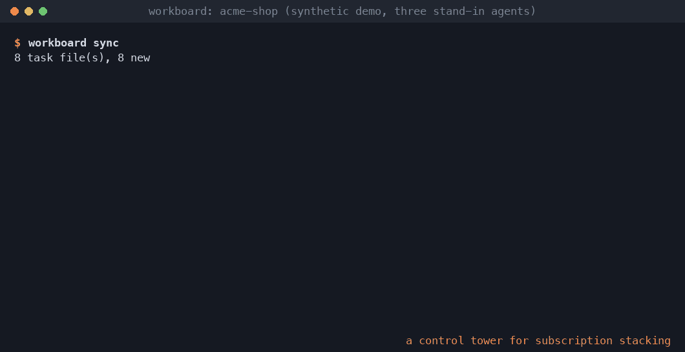
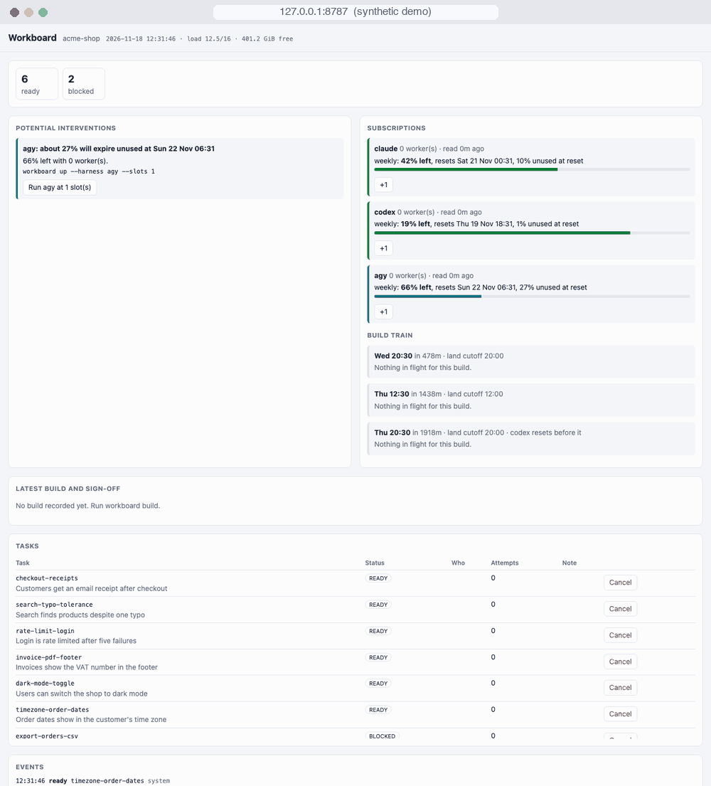
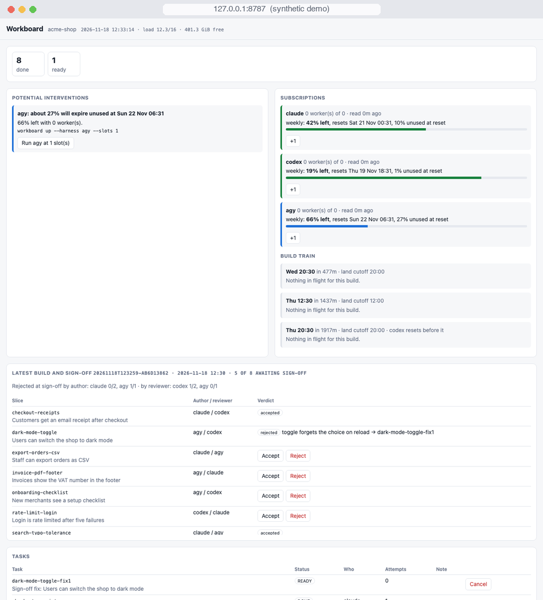

# Workboard

```text
__        __         _    _                         _
\ \      / /__  _ __| | _| |__   ___   __ _ _ __ __| |
 \ \ /\ / / _ \| '__| |/ / '_ \ / _ \ / _` | '__/ _` |
  \ V  V / (_) | |  |   <| |_) | (_) | (_| | | | (_| |
   \_/\_/ \___/|_|  |_|\_\_.__/ \___/ \__,_|_|  \__,_|

          a control tower for subscription stacking
```

[](https://github.com/adrianmcphee/workboard/actions/workflows/tests.yml)


[](LICENSE)

**You bought several all-you-can-eat agent subscriptions. Workboard helps you eat at all of them at once, without the agents fighting over the plates.**

It runs coding agents from several subscriptions on one repository as one delivery pipeline: every plan paced against its allowance, every result checked by another vendor's agent, every approved slice landed on main, and one page where you make the decisions the agents shouldn't.

```text
        +-------------------------------+
        |  plan C   cooling down        |   hit its limit: task requeued, no attempt lost
        +-------------------------------+
        |  plan B   under pace          |   has allowance to spare: takes the next task
        +-------------------------------+
        |  plan A   reviewing           |   checking plan B's homework
        +-------------------------------+
                        |
                        v
     one queue --> review --> main --> scheduled build --> you sign off
```

*I built Workboard to run my own stacked subscriptions, found it more useful than I expected, and decided to share it. (Adrian McPhee)*



*A synthetic demo: eight tasks on a made-up shop, three stand-in agents named after real CLIs, a review that fails once, a build, and one rejected slice turning into a fix task.*

The same run in the web console (`workboard dashboard`): what each plan has left, the build train with the slices in flight, sign-off with accept and reject buttons, every task and the event log, refreshing live on your own machine.



Workboard is a work queue and a control room. It hands tasks to agent CLIs (Claude Code, Codex, or any other that runs unattended), has an agent from a different vendor review each result, lands approved work on your main branch, and shows one page where a human sees what is happening and makes the decisions the fleet should not make for itself.

Python 3.11 or newer, standard library only, macOS and Linux. It runs on one machine today; [docs/vision.md](docs/vision.md) covers what comes next. Early software: version 0.1, interfaces may change.

If you are a coding agent, read [AGENTS.md](AGENTS.md) first.

## Why it exists: subscription stacking

Subscription stacking means paying for several flat-rate agent plans from different vendors and running them side by side. It sounds extravagant until you price the alternative. Over one month that included a busy delivery week, one developer's three agent tools recorded about 49 billion input tokens (97% of them cached) and 144 million output tokens in their local logs. Repriced at Together's listed GLM-5.3 API rates, that month would have cost about $14,900. The three subscriptions cost about $600 for the same month, roughly 25 times less. Repricing doesn't show that an open model would need the same tokens or give the same results, but for this workload the gap is large.

The busiest week shows what a super-heavy user stacking subscriptions looks like: about 25 billion input tokens and 106,000 model calls in seven days. Kept up for a month, that pace would be about $32,000 at the same rates, 53 times the subscriptions and more than half the list price of a dedicated 8-GPU server, for one person.

Each subscription caps usage, though, which is why heavy users stack several. Doing that by hand, with a dozen terminals and a spreadsheet of reset times, creates new problems. Workboard exists to solve them.

| Problem with several subscriptions in parallel | How Workboard handles it |
|---|---|
| **Allowances run out unevenly.** Each plan has its own windows and resets. One runs dry mid-afternoon while another expires unused. | It reads each subscription's remaining allowance and reset time, works out whether it is under, on or over pace, and steers new work towards the plans with allowance to spare. A plan at its reserve stops taking new work until it resets. |
| **A quota error wastes work.** An agent stops mid-task when its plan hits a limit. | A quota error is recognised from the agent's output. That harness cools down, and the task goes back to the queue without using up an attempt. The next agent continues in the same worktree with notes on what was done. |
| **Agents tread on each other.** Several agents in one checkout overwrite each other's files. | Every task gets its own branch and worktree. Tasks declare the paths they expect to touch, and fresh work is steered away from paths already in flight. |
| **Sessions die and work is lost.** A closed terminal, a crash, a laptop lid. | Work is held under a lease with a heartbeat. A lost lease returns the task to the queue, and the worktree and handoff notes are kept for the next author. |
| **Nobody checks the work.** One vendor's agent marking its own homework repeats its own blind spots. | Each result is reviewed by an agent from a different harness before it lands. When you reject a slice later, the tally counts against both its author and its reviewer, so you can see which harness writes work you reject and which one passes it. |
| **Merging becomes the bottleneck.** Many finished branches queue up and conflict. | Branches are rebased and checked outside any lock; only the push holds a lock, for a second or two. A conflict goes back to an author with the conflicting files named. |
| **The machine saturates.** Every agent runs the full build. | Only fast guard commands run per task. The full build runs on a schedule against the combined main branch. New work pauses when load is too high or disk too low. |
| **Too much to watch.** Dozens of sessions, no overview. | One dashboard and `workboard status` show every task, every subscription's pace, the next build, and the decisions waiting on a human, each with the command or button that takes it. |
| **Nobody knows what is on main.** | Builds happen at fixed times, record exactly which tasks they contain, and a human accepts or rejects each one. A rejection becomes the next top-priority task. |
| **Stopping one agent kills the others.** Killing by process name takes out every agent running the same tool. | Each agent runs in its own process group and is stopped by that group only. |

## What it does not solve

- **Subscription terms.** Some vendors treat automated, unattended use differently from interactive use, and some plans exclude it. Check each vendor's current terms before running a fleet on a personal plan.
- **Permissions.** Agents run unattended with permission to edit files and run commands in their worktree. The human checkpoint is at review and build sign-off, not per command. Run the fleet on a machine and account where that is acceptable, and keep client or regulated code out unless you add a sandbox around the agents.
- **More than one machine.** Leases, the landing lock and worktrees are local. [docs/multi-machine.md](docs/multi-machine.md) is the design for several machines; it is not built yet.

## The Workboard delivery cycle

Every task goes through the same six stages. Each stage has one gate that decides whether the work moves on, and it is always clear whether an agent, Workboard or a person makes that call.

```
 workboard/tasks/*.md
       |
       v
  +---------+  lease   +-----------------+  evidence  +-------------------+  approved  +----------------+
  |  queue  | -------> | author          | ---------> | reviewer          | ---------> | land on main   |
  |         |          | harness A,      |            | harness B,        |            | rebase, guard, |
  |         |          | own worktree    |            | another vendor    |            | locked push    |
  +---------+          +-----------------+            +-------------------+            +----------------+
       ^                 | quota, crash,                | rejected                     | conflict
       |                 | timeout                      |                              |
       +-----------------+------------------------------+------------------------------+
                  takeover: back to the queue, same worktree, notes attached

  main --(scheduled build)--> build record --> human sign-off --> a rejection becomes a top-priority fix task
```

| Stage | What happens | Gate to move on | Decided by |
|---|---|---|---|
| **1. Plan** | A task file states one outcome, how to tell it is done, the paths it expects to touch and what it depends on. | Every dependency is done. | A person writes the task; an agent may draft it. |
| **2. Author** | A worker claims the task under a lease. An agent works in the task's own worktree and commits to the task branch. | Evidence: the worktree is clean, the branch has commits, history is linear, every guard passes. | The authoring agent, checked by Workboard. |
| **3. Review** | An agent from a different harness reads the branch against the brief and writes a verdict. | A pass, or a fail with defects that point at lines. | The reviewing agent. |
| **4. Land** | The branch is rebased onto main, guarded again, and pushed as a fast-forward under a short lock. Its worktree is retired. | The guards pass on the rebased commit and main has not moved. | Workboard. |
| **5. Build** | At fixed times the head of main is built in full, and the build records which slices it contains. | The build command passes. | Workboard, on a schedule. |
| **6. Sign-off** | A person accepts or rejects each slice in the build. | A rejection becomes the next top-priority task, with the note as its brief. | A person. |

When an attempt ends without a result (a quota stop, a crash, a timeout, a failed review or a landing conflict), the task goes back to the queue as a takeover. The next author continues in the same worktree, with notes on what happened.

### Why it works this way

- **One trunk, small slices.** Work lands directly on main in small, linear commits. There are no long-lived branches and no pull-request queue, because every place where finished work waits becomes the bottleneck once many agents work at once.
- **Evidence before opinion.** An attempt reaches review only when mechanical checks pass, so reviewers spend their time on whether the work is right, not on whether it builds.
- **A different vendor reviews.** Models from one vendor tend to share blind spots. A reviewer from another vendor catches more, and the sign-off tally shows which harness writes work you reject and which one lets it through.
- **Fast checks per slice, the full build per wave.** Guards are cheap enough to run on every landing. The expensive build runs once per scheduled wave, so its cost does not multiply with the number of agents.
- **Lock as little as possible.** Landing locks only the push, for a second or two. Paths are a notice board, not a lock: most parallel edits merge cleanly, and the ones that do not are cheaper to fix than to prevent.
- **People decide in batches.** No agent waits for a person to approve a step. A person judges finished slices at each build, decides how fast to spend each subscription, and deals with tasks that keep failing. Attention goes to outcomes, where it adds the most.
- **Failure is normal.** Quota stops, crashes and conflicts are expected when many agents run on capped plans. Each one returns the task to the queue with its work and notes intact.

[docs/operating-model.md](docs/operating-model.md) states the full set of git rules and the reason for each. [docs/vision.md](docs/vision.md) describes where Workboard is going: several machines, a mobile control room, and working alongside Herdr.

## Workboard and Herdr

[Herdr](https://herdr.dev) is an open-source terminal multiplexer built for coding agents. Workboard is a work queue. They solve different problems, and **you don't need Herdr to use Workboard**: Workboard runs its agents headless and needs only Python and git.

| | Herdr | Workboard |
|---|---|---|
| **Owns** | Terminals and agent sessions | The work: tasks, review, landing, builds, pace |
| **Knows** | What each agent is doing right now: working, blocked, done | What each agent should do next, who checks it, and when it lands |
| **You use it to** | Watch agents, type into them, keep sessions alive, reach them remotely | Hand out tasks, land checked work on main, decide in batches |
| **Needs the other** | No | No |

### Using them together today

Run Workboard's long-lived processes in Herdr panes, so they survive a closed laptop or a dropped SSH connection, and you can check in from another machine with `herdr --remote`:

```sh
herdr                                         # start or attach a Herdr session, then in its panes:
workboard dashboard                           # pane 1: the control room on http://127.0.0.1:8787
workboard up && workboard status              # pane 2: start the headless workers, check on them
tail -f .workboard/logs/<task>-author-*.log   # pane 3: follow one agent's output
```

Your own interactive agent sessions can live in other Herdr panes as usual; Workboard doesn't touch them.

### What's coming

A **Herdr runner**: Workboard will launch each agent in a Herdr pane instead of headless, so you can attach to any of them from your desktop or from Herdr's mobile app (which connects through herdr-core), and an agent Herdr reports as blocked will show up as a Workboard intervention. Leases, review and landing stay in Workboard. Herdr's socket API is marked unstable before its 1.0, so the runner will sit behind a small adapter, and headless stays the default. [docs/vision.md](docs/vision.md) has the details.

## Requirements

- Python 3.11 or newer. There are no other dependencies.
- Git, and a repository whose remote you can push to.
- At least one agent CLI with a non-interactive mode. Two or more from different vendors is what the cross-review and pacing are for.

## Install

```sh
pipx install git+https://github.com/adrianmcphee/workboard    # or: pip install git+https://github.com/adrianmcphee/workboard
```

Either provides the `workboard` command. From a clone, `pip install -e .` installs it in editable mode, and `python3 -m workboard` runs it without installing.

## Quick start

```sh
cd your-project
workboard init                      # writes workboard.toml and workboard/tasks/example-task.md
printf '.workboard/\n.worktrees/\n' >> .gitignore
$EDITOR workboard.toml              # enable one [harness.*] block per subscription
workboard sync                      # load task files into the queue
workboard up                        # start the workers each harness is configured for
workboard dashboard                 # http://127.0.0.1:8787
```

`workboard status` prints the same picture in the terminal.

## Tasks

A task is a file in the tasks folder (`workboard/tasks/` by default):

```markdown
---
id: sign-in-with-email
title: A user can sign in with an email link
priority: 100
paths: [src/auth, tests/auth]
depends_on: [user-table]
lease_min: 60
harness: claude
---
## Outcome
...
```

| Field | Meaning |
|---|---|
| `id` | Lowercase name, also used for the branch and worktree. Defaults to the file name. |
| `title` | One line stating what a user or engineer can do once it lands. |
| `priority` | Higher is claimed first. Default 100. |
| `paths` | Where the task expects to write. Advisory: fresh work is steered away from paths already in flight, and never refused. |
| `depends_on` | Tasks that must be done before this one is ready. |
| `lease_min` | Minutes an author gets per attempt. |
| `harness` | A mild preference for which harness authors it. |

Everything after the header is the brief. It is passed to the agent as text and never evaluated.

`workboard sync` adds new files and refreshes the definition of existing tasks without touching their progress. Removing a file does not remove a task; `workboard cancel` does. `workboard add` queues a task that has no file.

## Configuration

`workboard init` writes a commented `workboard.toml`. The parts that matter most:

```toml
[project]
rules = ["AGENTS.md"]                        # appended to every prompt, for every vendor

[guards]
commands = ["make lint", "make test-fast"]   # must pass before review and after rebase

[review]
cross_harness = true                         # prefer a reviewer from a different harness

[build]
schedule = ["12:30", "20:30"]
command = "make release-candidate"

[usage]
policy = "enforce"                           # enforce | advise | off
reserve_pct = 3                              # stop authoring on a plan with this little left
```

### One harness per subscription

A harness is any command that takes a prompt and works in the current directory. Give each subscription its own block:

```toml
[harness.claude]
command = ["claude", "-p", "--dangerously-skip-permissions"]
prompt = "stdin"
slots = 2
usage = "claude-code"
quota_patterns = ["usage limit", "rate_limit", "hit your limit"]

[harness.codex]
command = ["codex", "exec", "--dangerously-bypass-approvals-and-sandbox", "-"]
prompt = "stdin"
slots = 2
usage = "codex"
quota_patterns = ["usage limit", "insufficient_quota", "429 Too Many"]
```

| Field | Meaning |
|---|---|
| `command` | The CLI and its arguments. `{worktree}`, `{prompt_file}` and `{model}` are substituted. |
| `prompt` | How the prompt arrives: `stdin`, `arg` (the final argument) or `file` (via `{prompt_file}`). |
| `model`, `model_flag` | When both are set, `model_flag model` is appended to the command. |
| `slots` | How many agents of this harness run at once. |
| `quota_patterns` | Regular expressions that mark the agent's output as a quota stop. |
| `cooldown_min` | How long a harness rests after a quota stop. Default 30. |
| `usage`, `usage_command` | Where its remaining allowance is read from (see [Subscriptions and pace](#subscriptions-and-pace)). |
| `env`, `env_unset` | Environment variables to set or remove for this agent. |

Agents run unattended inside the task worktree, so the command needs whatever flag lets that CLI edit files and run commands without asking. Read your CLI's documentation on what that grants.

The harness name is what cross-review compares. Two harnesses on the same vendor count as different, so where independence matters, make sure at least two vendors are configured.

### A pay-per-token harness for overflow

A harness does not have to be a subscription. An agent CLI pointed at a per-token provider, such as Codex with a profile for an open model, can take work when every plan is at its reserve. Report its spend against a monthly budget through `usage = "command"`, and the same pacing applies:

```toml
[harness.codex-open]
command = ["codex", "exec", "--profile", "glm", "--dangerously-bypass-approvals-and-sandbox", "-"]
prompt = "stdin"
slots = 1
usage = "command"
usage_command = ["./scripts/spend.sh"]   # your script: spend as a share of the monthly budget
```

## How a task moves

```
BLOCKED -> READY -> CLAIMED -> AWAITING_REVIEW -> REVIEWING -> LANDING -> DONE
                       |                              |            |
                       +------> NEEDS_TAKEOVER <------+------------+
                                      |
                                NEEDS_TRIAGE
```

- **NEEDS_TAKEOVER:** an attempt ended without a result, a review rejected the branch, or landing hit a conflict. The worktree and a notes file are kept, and the next author continues from them. A harness that just failed a task is the last choice to take it again.
- **NEEDS_TRIAGE:** the attempt limit was reached. Workers stop claiming the task until a human runs `workboard requeue`.
- **A quota stop is not an attempt.** When an agent's output matches a `quota_patterns` entry, that harness cools down and the task returns to the queue without spending an attempt.
- **A reviewer that writes no verdict has not rejected anything.** The review is offered to another harness.

Every transition is one transaction and one row in the event log, with the actor that caused it (`workboard events`, `workboard show <task>`).

## Landing

With `[land] command` empty, Workboard lands a branch itself:

1. Fetch, then rebase the branch onto main. A conflict aborts the rebase, names the conflicting files, and returns the task to an author.
2. Run the guards on the rebased branch.
3. Take the landing lock, fetch again, and push the exact guarded commit to main if main has not moved. If it has, release the lock and start again.

The landed task's worktree and branch are then removed. A worktree with uncommitted changes is never removed.

Set `[land] command` to use your own landing script instead. It runs in the task worktree with `WORKBOARD_TASK` and `WORKBOARD_BRANCH` set, under the same lock.

## Builds and sign-off

`workboard build` checks out the head of main in its own worktree, runs `[build] command`, and writes a record: the commit range since the last good build, the tasks that landed in it with their author and reviewer, and the tasks that were expected but missed. Run it from cron or launchd at the times in `[build] schedule`:

```
30 12,20 * * *  cd /path/to/project && workboard build
```

Then give each slice a verdict, on the dashboard or in the terminal:

```sh
workboard builds --latest
workboard signoff accept sign-in-with-email
workboard signoff reject sign-in-with-email --note "the link works twice"
```

A rejection queues `<task>-fix1` at top priority with your note as its brief, and counts against both the author and the reviewer of the original.

Every author and reviewer prompt states the build that slice is going for, the land cutoff, and what happens if it misses.

## Subscriptions and pace

Workboard reads how much of each subscription is left and when it resets:

| `usage` | Source |
|---|---|
| `claude-code` | The usage cache Claude Code keeps in `~/.claude.json` |
| `codex` | The latest rate-limit record in `~/.codex/sessions` |
| `command` | Your own `usage_command`, printing `{"windows": [{"label": "weekly", "used_pct": 40, "resets_at": "...", "window_hours": 168}]}` |
| `none` | No reading; the fleet reacts only to a quota error |

Nothing here calls a provider or reads a credential.

From each reading it works out a burn rate and a pace: `under` (allowance will expire unused), `on`, `over` (it will run out before the reset) or `reserve` (almost none left). That feeds back in two ways:

- **Claims.** A harness at reserve is refused new authoring until its reset. A harness over pace yields only while another running harness is under pace. Reviews are never refused. A reading older than three hours is shown but never acted on.
- **Prompts.** Each agent is told its remaining allowance, and an agent on an over-pace subscription is told to avoid broad exploration, never to skip guards.

The fleet never lowers total throughput on its own. When every subscription is over pace, the choice between speed now and lasting until the reset is shown to you.

Set `[usage] policy = "advise"` to keep the display and drop the refusals.

## Interventions and the dashboard



The dashboard lists **potential interventions**: decisions that need a human, each with the command that takes it and usually a button. Examples are a subscription that will run dry, a task parked for triage, a task on its fourth attempt, work blocked behind a cancelled dependency, and critical-path work nobody has claimed.

Other controls on the page: change the number of workers per harness, cancel or requeue a task, and accept or reject each slice of the latest build.

The dashboard binds to `127.0.0.1`. Every write needs a token that only the served page carries, sent in a custom header, plus a loopback `Host` header, so another site open in your browser cannot trigger an action. Do not expose the port beyond the machine.

## Commands

| Command | Does |
|---|---|
| `workboard init` | Write a starter `workboard.toml` and example task |
| `workboard sync` | Load task files into the queue |
| `workboard status [--json]` | Summary, usage, build train and interventions |
| `workboard board` | Every task, one per line |
| `workboard show <task>` | One task with its history |
| `workboard add <id> --title ...` | Queue a task without a file; the brief comes from `--brief` or stdin |
| `workboard priority <task> <n>` | Change a task's priority |
| `workboard requeue <task>` | Give a parked or cancelled task fresh attempts |
| `workboard cancel <task>` | Stop a task |
| `workboard up [--harness h] [--slots n]` | Start workers or change how many run |
| `workboard down [--harness h] [--now]` | Stop workers after their current task, or immediately |
| `workboard worker --harness h [--once]` | Run one worker in the foreground |
| `workboard land` | Land every reviewed task that is waiting |
| `workboard build` | Build the head of main and record its manifest |
| `workboard builds [id] [--latest]` | List builds or show one |
| `workboard signoff accept\|reject <task>` | Give a verdict on a slice of a build |
| `workboard usage [--json]` | Allowance, resets and pace per harness |
| `workboard interventions [--json]` | Decisions waiting on a human |
| `workboard events` | The event log |
| `workboard dashboard` | Serve the control room page |

Lowering `--slots` never kills an agent: the extra workers finish their current task and exit. `workboard down --now` stops agents mid-task, and their tasks continue later as takeovers.

## Where state lives

| Path | Content |
|---|---|
| `workboard.toml` | Configuration, committed with the project |
| `workboard/tasks/*.md` | Task definitions, committed with the project |
| `.workboard/workboard.db` | Queue, attempts, events and worker registry |
| `.workboard/handoffs/<task>/` | Rendered prompts, takeover notes, review verdict |
| `.workboard/logs/` | Agent, landing, build and worker output |
| `.workboard/builds/` | Build records and sign-off verdicts |
| `.worktrees/<task>/` | One checkout per open task |

`.workboard/` and `.worktrees/` are local and belong in `.gitignore`.

## Limits

- One machine. Every worker for a project runs on the same host. [docs/multi-machine.md](docs/multi-machine.md) is the design for several.
- Allowance is read per harness. Two harnesses signed in to the same subscription each see the whole allowance; grouping by account is part of the multi-machine design.
- The reviewer reads the branch as authored; the commit that lands is that branch rebased and guarded again.
- A failed build lists the tasks landed since the last good one. It does not bisect them.

## Tests

```sh
python3 -m unittest discover -s tests -t .
```

The suite drives the real worker loop against temporary git repositories with a stand-in agent, so it needs git and no network.

## Contributing and security

See [CONTRIBUTING.md](CONTRIBUTING.md) for how to propose changes, and [SECURITY.md](SECURITY.md) for the threat model and how to report a vulnerability.

## Licence

MIT. See [LICENSE](LICENSE).
